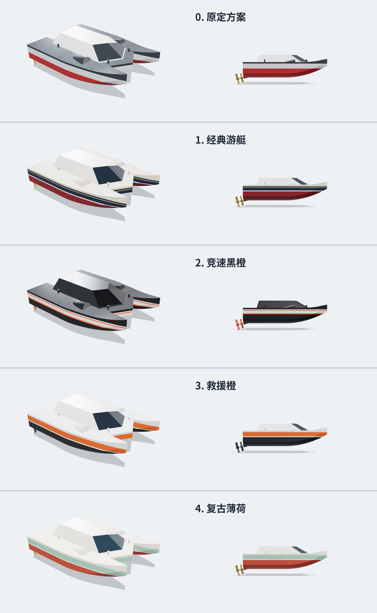

# Boat QB12 · 手柄遥控的 3D 打印双体船

[English](README_en.md)



一艘从零做起的遥控双体船：自己画的主控板（嘉立创 SMT 贴片）、程序化生成的 3D 打印船体、ESP32-S3 固件，用 Xbox 手柄（蓝牙）或手机网页（Wi‑Fi）遥控。
配套两门网页课，讲清楚这块板子上每个电路为什么这样设计、PCB 怎么一步步画出来。

整个项目是和 AI 编程助手（Claude Code）一起做的，协作用的规则文件也放在仓库里，见下面的「和 AI 一起做」。

## 里面有什么

| 部分 | 内容 | 位置 |
|---|---|---|
| 主控板 | ESP32-S3-WROOM-1 + DRV8833 双路电机驱动 + TP4056 锂电充电 + AP2112K 3.3 V 稳压，USB-C，2 层板 56 × 38 mm | `hardware/pcb/` |
| 船体 | 双体船身、甲板（船头插舌 + 船尾旋钮扣，免螺丝）、舱罩、旋钮，Python 脚本生成 | `hardware/hull/` |
| 装配检查 | 板子、电机、电池、尾轴和船体有没有干涉，逐项算体积重叠 | `hardware/fitcheck/` |
| 固件 | Arduino + Bluepad32：Xbox 手柄模式、手机热点网页模式、低电压保护、插 USB 时禁用电机 | `firmware/` |
| 3D 预览 | three.js 预览页、装配动画 | `viewer/` |
| 电路课 | 10 课，从 USB-C 供电讲到 H 桥和 PWM，都以这块板子为例 | `courses/circuit/` |
| PCB 课 | 9 课，从原理图、布局、布线讲到 DRC 和嘉立创下单 | `courses/pcb/` |
| 成品文件 | Gerber、BOM、坐标文件、STL、KiCad 工程包、课程网页 | `outputs/QB12/` |
| 文档 | 开发环境、踩过的坑、设计评审、开放问题 | `docs/` |

## 直接用成品

**在线看课和 3D 预览：https://galis.github.io/qb12-boat/**

- **看课**：上面的网址，或者下载后用浏览器打开 `outputs/QB12/QB12_电路课.html`、`outputs/QB12/QB12_PCB课.html`，单文件，不用联网。
- **做板子**：嘉立创下单用 `outputs/QB12/` 里的 `QB12_Gerber.zip`、`QB12_BOM_嘉立创SMT.csv`、`QB12_CPL_坐标文件.csv`。ESP32 模组要选标准型 SMT（经济型不贴）。
- **打印船体**：`QB12_hull.stl`、`QB12_deck.stl`、`QB12_canopy.stl`、`QB12_knob.stl`（旋钮打 2 个）。我们用的是树脂打印。
- **烧固件**：见 `firmware/README.md`。

## 从源文件重新生成

环境（macOS 上做的，Linux 大体一样）：Python 3.12、KiCad 10、arduino-cli、Java 21（Freerouting 用）。详细步骤见 `docs/开发环境.md`。

```bash
python3 -m venv .venv && source .venv/bin/activate && pip install -r requirements.txt

# 船体 → STL / USDZ，再做装配检查
cd hardware/hull && python build_model.py out && python export_assembly.py out && cd ../..
python hardware/fitcheck/check_pcb_fit.py

# 固件
firmware/build.sh

# PCB 课页面 + 测试
cd courses/pcb && python build.py --strict && python tools/test.py
```

自动布线用的 Freerouting 1.9.0 没有放进仓库，要从 [官方发布页](https://github.com/freerouting/freerouting/releases/tag/v1.9.0) 下载，放到 `tools/freerouting-1.9.0.jar`。

## 现状和已知问题（Rev A）

- 板子已打样、上电，桌面测试全部通过：充电、电池电压检测、手柄连接、两个电机正反转。
- 第一次下水能跑，但蓝牙不到 10 m 就断了。推测原因：PCB 天线离水面只有约 1.3 cm，Xbox 手柄的发射功率又小。固件已加手机 Wi‑Fi 模式，还没实测距离。Rev B 打算换外接天线的模组（ESP32-S3-WROOM-1U），把天线竖高。
- 其他评审意见见 `docs/QB12_RevA_评审.md`，没解决的问题见 `docs/开放问题.md`。

## 和 AI 一起做

- `CLAUDE.md`：每次对话都会带上的项目规则（目录、常用命令、禁区、怎么派子任务、怎么汇报）。
- `PLAN.template.md`：长任务的进度记录模板。AI 的对话上下文会被压缩，进度和决定要写进文件，下次接着做。
- `docs/坑.md`：踩过的坑，按领域分组，写成「现象 → 原因/做法」。
- `courses/pcb/AUTHORS.md`：PCB 课是分课交给多个 AI 子任务并行写的，这是给它们的统一说明。

## 许可证

- 硬件设计（`hardware/`、`outputs/QB12/` 里的制造文件）：CERN-OHL-P-2.0
- 代码（`firmware/`、`viewer/`、`tools/` 和各处的构建脚本）：MIT
- 文档和课程（`docs/`、`courses/` 的课文）：CC BY 4.0

详见 [LICENSE](LICENSE)。元件 3D 模型等第三方内容见 [NOTICE.md](NOTICE.md)。
