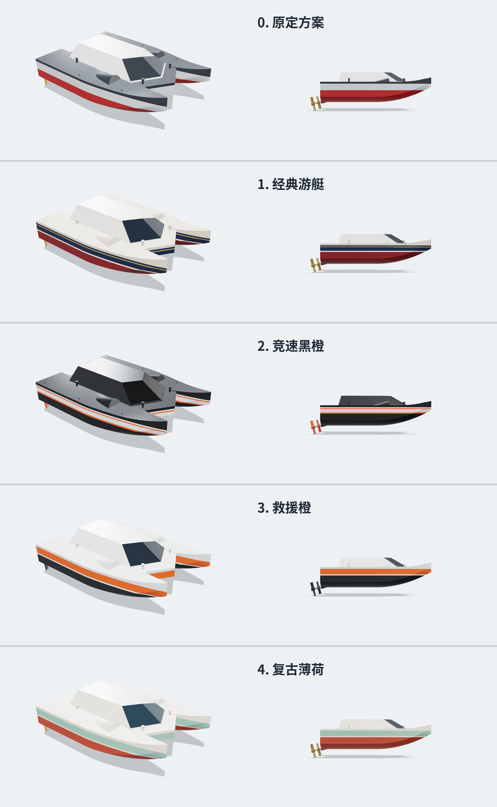

# Boat QB12 · a gamepad-controlled, 3D-printed catamaran

[中文](README.md)



An RC catamaran built from scratch: a custom main board (assembled by JLCPCB SMT), a 3D-printed hull generated by Python scripts, and ESP32-S3 firmware. You drive it with an Xbox controller over Bluetooth, or from a phone web page over Wi‑Fi.
Two interactive web courses (in Chinese) explain why every circuit on this board is designed the way it is, and how the PCB was laid out step by step.

The whole project was built together with an AI coding assistant (Claude Code). The rule files used for that are included; see "Working with AI" below.

Code comments and documents are in Simplified Chinese.

## What's inside

| Part | Contents | Path |
|---|---|---|
| Main board | ESP32-S3-WROOM-1 + DRV8833 dual motor driver + TP4056 Li-ion charger + AP2112K 3.3 V LDO, USB-C, 2 layers, 56 × 38 mm | `hardware/pcb/` |
| Hull | Twin hulls, deck (bow tongue + two stern twist locks, no screws), canopy, knobs; generated by Python | `hardware/hull/` |
| Fit check | Checks the board, motors, battery and shafts against the hull by computing overlap volumes | `hardware/fitcheck/` |
| Firmware | Arduino + Bluepad32: Xbox controller mode, phone hotspot web mode, low-battery protection, motors disabled while on USB | `firmware/` |
| 3D viewer | three.js preview page and assembly animation | `viewer/` |
| Circuit course | 10 lessons, from USB-C power to H-bridges and PWM, all using this board | `courses/circuit/` |
| PCB course | 9 lessons, from schematic, placement and routing to DRC and ordering | `courses/pcb/` |
| Ready-made files | Gerber, BOM, pick-and-place, STL, KiCad project archive, course pages | `outputs/QB12/` |
| Docs | Dev setup, pitfalls, design review, open questions | `docs/` |

## Use the ready-made files

**Courses and 3D preview online: https://galis.github.io/qb12-boat/**

- **Courses**: use the link above, or open `outputs/QB12/QB12_电路课.html` (circuit) or `outputs/QB12/QB12_PCB课.html` (PCB) in a browser. Single files, work offline.
- **Board**: order with `QB12_Gerber.zip`, `QB12_BOM_嘉立创SMT.csv` (BOM) and `QB12_CPL_坐标文件.csv` (pick-and-place) from `outputs/QB12/`. Choose standard SMT assembly so the ESP32 module gets placed.
- **Hull**: print `QB12_hull.stl`, `QB12_deck.stl`, `QB12_canopy.stl` and two `QB12_knob.stl`. Ours was resin-printed.
- **Firmware**: see `firmware/README.md`.

## Rebuild from source

Built on macOS (Linux should be similar): Python 3.12, KiCad 10, arduino-cli, Java 21 (for Freerouting). Details in `docs/开发环境.md`.

```bash
python3 -m venv .venv && source .venv/bin/activate && pip install -r requirements.txt
cd hardware/hull && python build_model.py out && python export_assembly.py out && cd ../..
python hardware/fitcheck/check_pcb_fit.py
firmware/build.sh
cd courses/pcb && python build.py --strict && python tools/test.py
```

Freerouting 1.9.0 (autorouter) is not included. Download it from the [official release page](https://github.com/freerouting/freerouting/releases/tag/v1.9.0) and save it as `tools/freerouting-1.9.0.jar`.

## Status and known issues (Rev A)

- Boards were made and powered up; all bench tests passed: charging, battery voltage sensing, controller pairing, both motors in both directions.
- On the first launch the boat ran, but Bluetooth dropped within 10 m. Likely causes: the PCB antenna sits only about 1.3 cm above the water, and the Xbox controller's transmit power is low. The firmware now also has a phone Wi‑Fi mode; its range has not been measured yet. Rev B plans an external-antenna module (ESP32-S3-WROOM-1U) with the antenna raised.
- Review notes: `docs/QB12_RevA_评审.md`. Open questions: `docs/开放问题.md`.

## Working with AI

- `CLAUDE.md`: project rules loaded into every session (layout, commands, no-go areas, delegating to sub-agents, reporting).
- `PLAN.template.md`: a progress template for long tasks. The AI's context gets compacted, so progress and decisions are written to a file.
- `docs/坑.md`: pitfalls, grouped by area, written as "symptom → cause / fix".
- `courses/pcb/AUTHORS.md`: the PCB course was written lesson by lesson by parallel AI sub-tasks; this is the shared brief they got.

## License

- Hardware designs (`hardware/`, manufacturing files in `outputs/QB12/`): CERN-OHL-P-2.0
- Code (`firmware/`, `viewer/`, `tools/` and build scripts): MIT
- Docs and courses (`docs/`, lesson content in `courses/`): CC BY 4.0

See [LICENSE](LICENSE). Third-party content such as component 3D models is listed in [NOTICE.md](NOTICE.md).
